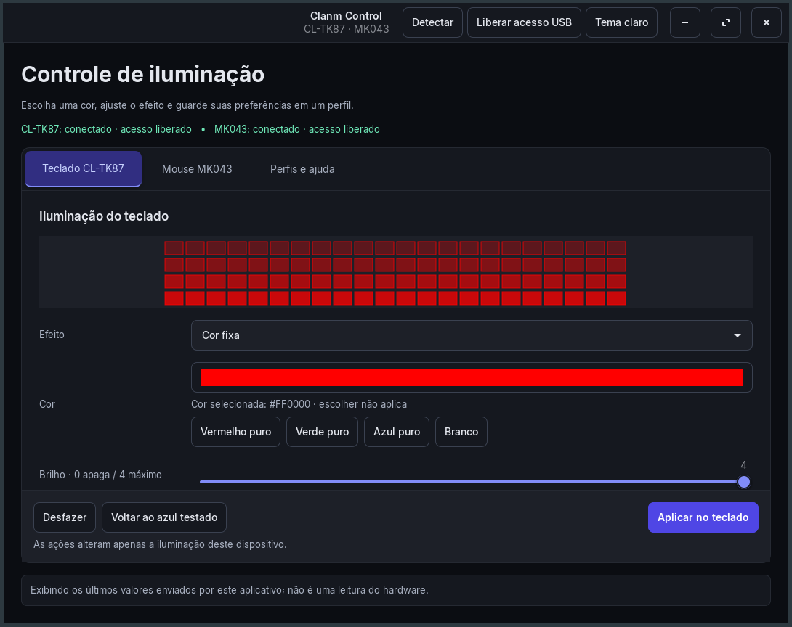

# Clanm Control Linux 0.3

Aplicativo GTK em português para iluminação do teclado Clanm CL-TK87 e do mouse MK043. Não depende de Wine nem executa o software Windows.

## Baixar e instalar

Baixe o ZIP da [última versão](https://github.com/Handerson-Henri/clanm-control-linux/releases/latest), extraia e abra um terminal na pasta extraída:

```bash
bash instalar.sh
```

Abra **Clanm Control** no menu. Também funciona com `bash iniciar.sh` na pasta extraída.

No Zorin/Ubuntu/Debian, se faltarem dependências:

```bash
sudo apt install python3 python3-gi gir1.2-gtk-3.0 libusb-1.0-0
```

PyUSB acompanha o pacote com sua licença; não precisa de pip. Em outras distribuições, instale os pacotes equivalentes pelo gerenciador local. O ambiente usado nos testes foi Zorin OS 18.1; outras distribuições ainda precisam de confirmação.

Se precisar, clique em **Liberar acesso USB**. A autenticação ocorre na janela do sistema para instalar regras específicas dos dispositivos. Se o acesso continuar bloqueado, reconecte o periférico e clique em Detectar. Nenhuma configuração é enviada ao abrir o aplicativo, carregar um perfil ou escolher uma cor.

## Suporte atual

| Dispositivo | Identificador USB | Disponível | Confirmado fisicamente |
|---|---|---|---|
| Clanm CL-TK87 | `320f:5078` | Cor, brilho, efeitos, velocidade, direção; leitura e cópia dos parâmetros de luz | Azul e vermelho fixos |
| Clanm CL-MK043 / MK043 | `04d9:a09f` | Cor fixa ou LEDs desligados; aplicação limitada à iluminação | Azul, vermelho e LEDs desligados ao longo do desenvolvimento |

Identificadores podem ser compartilhados entre modelos. O suporte foi testado neste kit, sem garantia para todo periférico com o mesmo VID/PID. Não inclui controle de DPI, macros, remapeamento de teclas, firmware ou alteração de botões.

## Aparência



Também oferece [tema claro](preview-light.png). Ações de aplicação e recuperação ficam fixas no rodapé.

## Recuperação

Em cada dispositivo existem dois botões:

- **Voltar ao azul testado:** aplica iluminação azul fixa. No mouse, envia somente comandos de luz. É um perfil de recuperação; **não é reset de fábrica**.
- **Desfazer última iluminação:** restaura a cópia anterior salva pela versão 0.2. No teclado, a cópia vem da leitura dos parâmetros reais antes da escrita; no mouse, vem do último modo/cor registrado pelo aplicativo. Fica indisponível até haver uma cópia. Não recupera o estado anterior à primeira instalação.

Não tínhamos uma cópia da configuração original de fábrica. Por isso, o aplicativo não oferece uma falsa restauração de fábrica nem promete que retirar o cabo desfaça mudanças persistentes.

## Cores

Há botões **Vermelho puro**, **Verde puro**, **Azul puro** e **Branco**, além do seletor. O código hexadecimal aparece na tela. Escolher uma cor não a aplica; clique em Aplicar quando quiser.

Após o relato de vermelho rosado no teclado, o último valor registrado foi `#A51D2D`, que contém verde e azul. Isso é uma hipótese para o tom percebido, não diagnóstico físico confirmado. O botão Vermelho puro seleciona exatamente `#FF0000` e os testes conferem esses bytes no pacote. Depois dessa revisão, o usuário confirmou vermelho nos dois dispositivos.

## Teclado CL-TK87

Detectado por `320f:5078`, interface RGB 1. A versão anterior teve **azul fixo confirmado fisicamente** pelo usuário após correção do offset dos parâmetros. A ferramenta oferece 18 efeitos, brilho, cor, velocidade e direção conforme cada modo. As combinações não foram todas testadas fisicamente.

A versão 0.2 salva os oito parâmetros atuais antes de enviar uma alteração, verifica a leitura de retorno e permite desfazer. Não grava firmware, macros ou remapeamentos de teclas.

## Mouse MK043: apenas luz

Detectado por `04d9:a09f`, configuração pela interface USB 2. A versão 0.1 teve apagar LEDs e azul fixo confirmados pelo usuário, mas enviava o perfil completo.

**Na versão 0.2, DPI, sensibilidade, taxa de consulta, LOD e botões foram retirados da interface e do caminho de aplicação.** O backend recusa perfis completos nessa operação. Aplica somente cor fixa ou desligado, por dois comandos RGB/efeito, sem escrever paletas ou registros de desempenho.

O caminho de iluminação foi conferido por análise estática, testes simulados e pelo usuário, que confirmou vermelho nos dois dispositivos. Nenhum comando USB foi enviado durante a revisão visual 0.3. A configuração original de fábrica e o DPI anterior à versão 0.1 não foram capturados, portanto não podem ser reconstruídos a partir destes arquivos.

## Perfis após formatar

Salve um JSON na aba **Perfis e ajuda**. Depois de formatar, reinstale, libere o acesso USB, carregue o JSON e aplique somente quando desejar. Perfis antigos podem conter valores de DPI/botões, mas a versão atual usa apenas a iluminação do mouse e não envia esses campos.

Os registros locais ficam em `~/.config/clanm-control/`: `last-applied.json` e `undo-lighting.json`. Contêm ajustes de iluminação e, em arquivos antigos, valores históricos do formulário. Não contêm contas, senhas ou sessões.

## Verificar

```bash
PYTHONPATH=vendor:. /usr/bin/python3 -m unittest discover -s tests -v
bash iniciar.sh --detect
```

Os testes verificam pureza dos canais RGB, comandos permitidos, recuperação, limites, checksums e ausência de acesso USB em entradas recusadas. Testes de pacote não equivalem a ensaio físico dos periféricos.

Veja [protocolo e histórico](docs/PROTOCOLO.md) e [créditos](THIRD_PARTY.md). Licença GPL-2.0-or-later.


## Aparência 0.3

A interface adapta o Design System do Prints & Paints: paleta índigo, fonte Inter, tokens de cor/tipografia/espaçamento centralizados, temas claro e escuro e ações fixas fora da área de rolagem. **Aplicar**, **Desfazer** e **Voltar ao azul testado** permanecem visíveis. A preferência de tema é salva localmente e não altera os periféricos.

[Decisões de design](docs/DESIGN.md). As prévias mostram valores escolhidos na tela; a ilustração não mede os LEDs reais.


## Comunidade

Contribuições e relatos de teste são bem-vindos. Leia [CONTRIBUTING.md](CONTRIBUTING.md). Projeto independente, sem vínculo oficial com a Clanm. Não inclui programas proprietários do fabricante.
